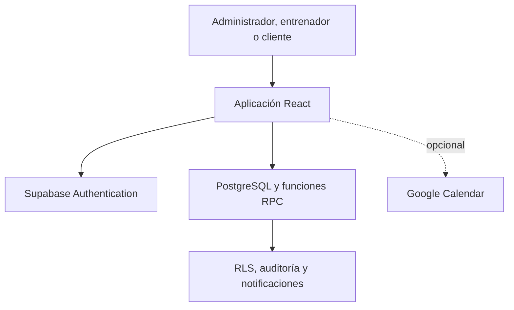

# Manual técnico

## 1. Identificación

- Sistema: Coaches Connection.
- Frontend: versión 1.6.0.
- Backend mínimo: versión 1.4.0.
- Finalidad: piloto institucional de gestión de entrenadores y clientes.
- Escala prevista: 6 administradores, 20 entrenadores y hasta 1000 clientes registrados.

## 2. Arquitectura

El frontend es una aplicación React construida con Vite. Utiliza el cliente público de Supabase para Authentication, consultas PostgreSQL, funciones RPC y suscripciones en tiempo real. Las políticas RLS y las funciones del backend determinan qué puede consultar o modificar cada rol.



El rol mostrado por el frontend no concede permisos por sí mismo. La autorización efectiva debe mantenerse en el backend mediante RLS y funciones protegidas.

## 3. Requisitos técnicos

- Windows 10/11, macOS o Linux.
- Node.js 20.19.0 o superior.
- npm incluido con Node.js.
- Proyecto de Supabase configurado con las Fases 1 a 4.
- Navegador actualizado: Chrome, Edge, Firefox o Safari.
- HTTPS obligatorio para cualquier despliegue accesible fuera del equipo local.

## 4. Instalación local

```powershell
Set-Location "C:\Proyectos\Coaches-Connection-Opcion-B-Fase-6"
Copy-Item ".env.example" ".env"
notepad ".env"
npm install
npm run check
npm run dev
```

El archivo `.env` debe contener la URL del proyecto y la clave pública `anon` o `publishable`. Nunca debe contener la clave `service_role` ni una clave secreta.

## 5. Preparación del backend existente

Si la Fase 4 ya funciona, no ejecutes nuevamente migraciones. Abre Supabase → SQL Editor, copia el contenido completo de `supabase/verificar_fase5_calidad.sql` y ejecútalo. Los controles booleanos deben ser verdaderos, los conteos de inconsistencias deben ser cero y la versión debe ser `1.4.0` o superior.

Para una instalación nueva, sigue el orden documentado en `supabase/README.md`. Los cambios de estructura solo deben ejecutarlos responsables autorizados y con respaldo previo.

## 6. Comandos

| Comando | Función |
|---|---|
| `npm run dev` | Servidor local de desarrollo |
| `npm run build` | Compilación de producción |
| `npm run preview` | Vista local de la compilación |
| `npm run preview:network` | Vista previa accesible en la red del piloto |
| `npm run lint` | Análisis estático |
| `npm run test` | Pruebas automáticas |
| `npm run test:coverage` | Pruebas y cobertura |
| `npm run test:integration` | Verificación de solo lectura contra Supabase real |
| `npm run test:performance` | Compilación y presupuesto de carga |
| `npm run test:deliverables` | Verificación documental de la Fase 6 |
| `npm run check` | Control completo previo al despliegue |

## 7. Despliegue de prueba

### Vercel

1. Importar la carpeta en un repositorio privado autorizado.
2. Configurar framework Vite y directorio de salida `dist`.
3. Registrar las variables de `.env.production.example` en la configuración del proyecto.
4. Desplegar y copiar la URL HTTPS resultante.
5. Añadir esa URL en Supabase Authentication → URL Configuration.

`vercel.json` ya contiene la compilación, redirección a `index.html` y cabeceras básicas.

### Netlify

1. Importar el repositorio.
2. Configurar las variables públicas.
3. Publicar con `npm run build` y directorio `dist`.
4. Autorizar la URL resultante en Supabase.

`netlify.toml` y `public/_redirects` contienen la configuración del frontend.

## 8. Prueba de humo posterior al despliegue

1. Abrir la URL en una ventana privada.
2. Iniciar sesión con una cuenta de prueba de cada rol.
3. Comprobar que cada rol ve únicamente su menú.
4. Crear o usar un cliente de prueba autorizado.
5. Asignar una rutina y programar una sesión de prueba.
6. Confirmar notificaciones y reportes.
7. Verificar que un cliente no puede acceder a reportes administrativos.
8. Cerrar sesión y comprobar que el panel queda protegido.

No debe usarse información real innecesaria durante esta comprobación.

## 9. Respaldo

Antes del piloto debe existir un respaldo verificable de la base de datos y un responsable designado. El manual no ejecuta el respaldo automáticamente. El responsable debe utilizar las herramientas autorizadas del proyecto Supabase, registrar fecha, alcance, ubicación protegida y periodo de conservación.

No se deben descargar tablas con documentos de identidad o datos personales a equipos no autorizados.

## 10. Recuperación

Ante una falla:

1. Suspender nuevas operaciones si existe riesgo de pérdida o exposición.
2. Registrar fecha, rol afectado, módulo y mensaje de error sin contraseñas ni tokens.
3. Confirmar el estado de Supabase y del proveedor de despliegue.
4. Volver a la última compilación estable si la falla pertenece al frontend.
5. Restaurar datos únicamente mediante el procedimiento institucional autorizado.
6. Repetir la prueba de humo antes de reanudar el piloto.

## 11. Mantenimiento

- Ejecutar `npm audit` y `npm run check` antes de cada entrega.
- Revisar dependencias en un entorno separado antes de actualizarlas.
- No cambiar simultáneamente frontend y base de datos durante una sesión del piloto.
- Mantener un registro de versiones, incidencias y responsables.
- Revocar cuentas de prueba al finalizar el estudio.

## 12. Límites

El sistema no sustituye los sistemas corporativos oficiales, no contiene facturación, no realiza diagnósticos, no prescribe tratamientos y no demuestra por sí solo cambios económicos o de retención.
